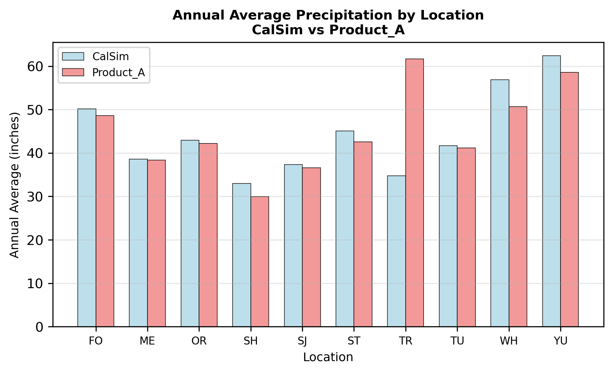
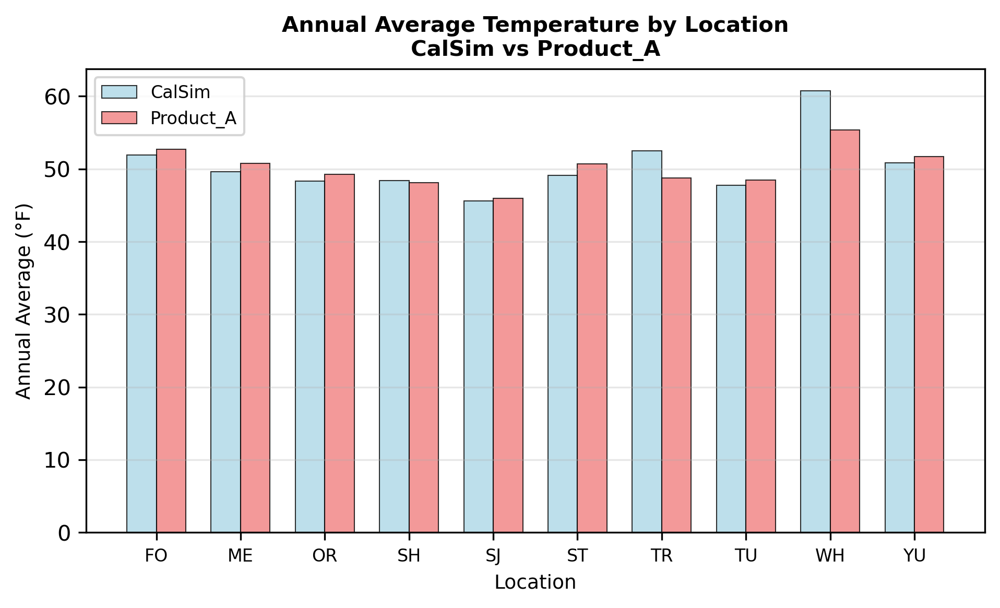
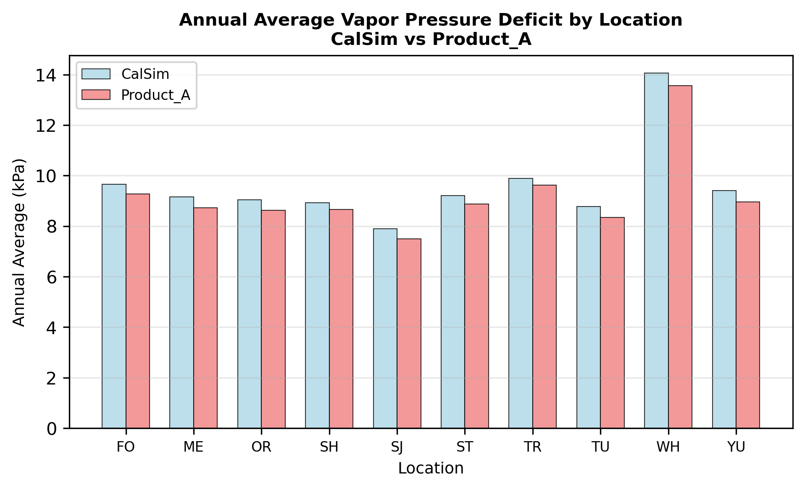
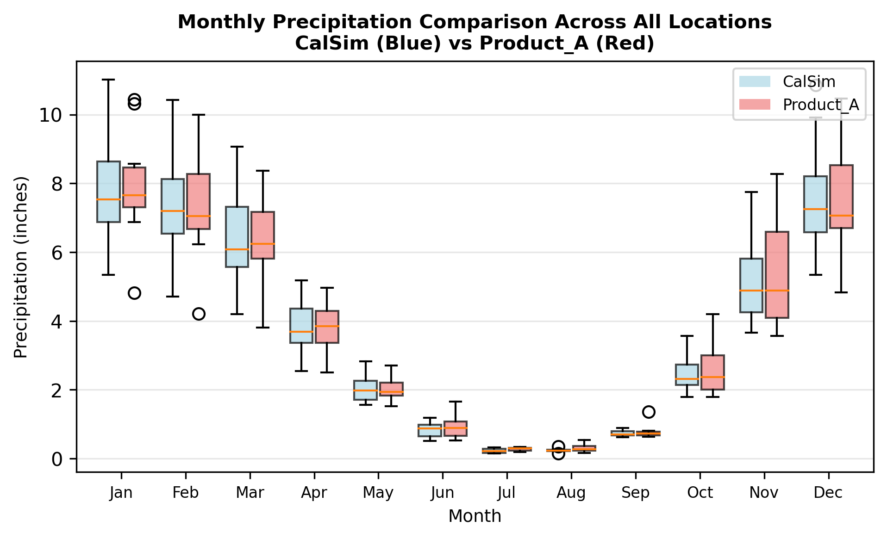
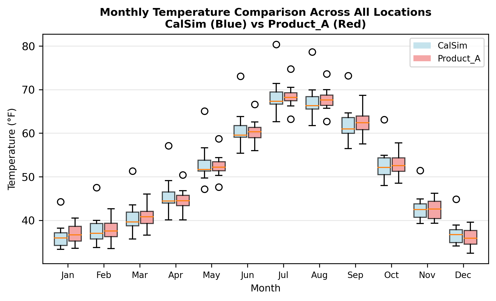
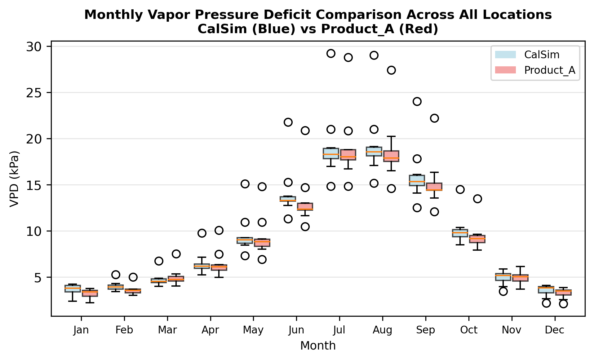

# mod_forcing/climate

```{admonition} Repository Module
:class: tip

**Module:** `mod_forcing/climate/`  
Climate extractions at point locations and basin averages; reference ET and crop ET for CalSimHydro
```

This module develops 56 inputs comprising 26 point locations (monthly precipitation at reservoir locations) and 30 basin-averaged upper watershed inputs (precipitation, temperature, and vapor pressure deficit for 10 watershed basins) that the forecast module uses to project water-year availability.

## Point precipitation and basin averages

The 26 point precipitation locations are extracted from the nearest WGEN grid cell to each reservoir coordinate. Because WGEN precipitation is used directly without bias correction, Product A values inherit any precipitation artifacts relative to the CalSim baseline record.

The 10 basin-averages (precipitation, temperature, VPD) are for the headwater inflow watersheds of the major CVP and SWP reservoirs. On the Sacramento side these are Shasta, Trinity, Whiskeytown, Oroville, Yuba, and Folsom; on the San Joaquin side, New Melones, Don Pedro, McClure, and Millerton. These basin averages are the Upper Headwater Hydrology (UHH) inputs to CalSim 3's hydroforecast DLL, the component that develops the water-year outlooks driving operational decisions. The UHH locations are defined in `reference/uhh_locations.csv`.

## Vapor pressure deficit reconstruction

Vapor pressure deficit (VPD) is hard to reconstruct because the weather generator does not produce the relative humidity or dew point temperature that VPD calculation normally requires. The reconstruction instead exploits the strong correlation between temperature and VPD at basin scale. Correlation analysis across all 10 basins found R > 0.97 between temperature and VPD, supporting a quantile mapping approach with temperature as the basis variable. The correlation reflects the physical relationship that warmer air holds more water vapor, which raises the vapor pressure deficit at a given absolute humidity. VPD is therefore quantile-mapped from basin-averaged temperature. Each basin's map is fitted once, on Historical_Unsplit temperature against the CalSim 3 VPD over WY 1922-2018, and applied to every set.

## Results

`_2_uhh_basin_averages.py` weights each grid cell by its area inside the basin (`reference/GridInfo/`). The figures of this section come from v1.0, which fitted the VPD map on Product A's own temperature. Temperature validation shows slightly higher temperatures in Product A and precipitation shows a slight negative bias. The figures below confirm that the reconstructed VPD distributions match the CalSim historical record across basins and seasons, which supports the temperature-based approach.

::::{tab-set}
:::{tab-item} Precipitation

*Annual average precipitation (inches) for 10 watershed basins, CalSim historical vs Product A. Most basins show a slight Product A deficit, consistent with WGEN behavior, except Trinity (TR), where Product A is notably higher than CalSim, likely reflecting the grid file discrepancy discussed below.*
:::
:::{tab-item} Temperature

*Annual average temperature (deg F) for 10 watershed basins, CalSim historical vs Product A. Most basins show close agreement, but Product A is generally 0.5-1.0 F higher. Whiskeytown (WH) is a notable outlier where CalSim averages approximately 61 deg F compared to Product A at approximately 55 deg F, suggesting a basin definition or elevation weighting discrepancy.*
:::
:::{tab-item} VPD

*Annual average vapor pressure deficit (kPa) for 10 watershed basins, CalSim historical vs Product A. Product A VPD is consistently slightly lower across all basins and Whiskeytown (WH) shows the largest discrepancy, mirroring its temperature offset.*
:::
:::{tab-item} Monthly Results (Precip)

*Monthly precipitation distribution (inches) aggregated across all 10 basins, CalSim historical (blue) vs Product A (red). Box plots show strong seasonal signal peaking in Dec--Jan (~8 inches median) and near-zero in Jul--Aug. Product A closely reproduces the CalSim monthly distributions and interquartile ranges across all seasons.*
:::
:::{tab-item} Monthly Results (Temp)

*Monthly temperature distribution (deg F) aggregated across all 10 basins, CalSim historical (blue) vs Product A (red). Seasonal cycle ranges from approximately 35 deg F in winter to approximately 68 deg F in summer. Product A closely matches CalSim medians and spreads. Upper outliers (circles reaching 73--80 deg F in summer months) reflect the Whiskeytown (WH) basin, which has the highest temperatures in the domain.*
:::
:::{tab-item} Monthly Results (VPD)

*Monthly vapor pressure deficit (kPa) aggregated across all 10 basins, CalSim historical (blue) vs Product A (red). VPD follows the temperature seasonal cycle, ranging from approximately 3--4 kPa in winter to approximately 18--19 kPa in Jul--Aug. Upper outliers reaching approximately 29 kPa in summer reflect the Whiskeytown basin. Product A reproduces the CalSim distributions well, confirming the temperature-based QM approach.*
:::
::::

**Errata**

Trinity watershed precipitation has larger validation discrepancies than expected. This may stem from a grid file mismatch in the source data. The precipitation compilation used the VIC grid file from the CalSim baseline hydrology dataset, whereas the forecast DLL may use a different grid file or spatial-averaging approach.

## Reference ET and crop ET

Two programs build the CalSimHydro evapotranspiration inputs from the WGEN weather: `CS3_RefETo.dss`, the monthly reference ETo per water budget area, and `CS3_ET.dss`, the crop ET per area and land use type. They follow the one factor method DWR adopted for CalSim 3, documented in the user manual *Calculating Reference Evapotranspiration (Ref ETo) for California and CalSim 3 Domain Using PRISM Data and the Hargreaves-Samani Equation* (Mohammad Monirul Hasan, DWR Modeling Support Office) and its memo: Hargreaves-Samani ETo from daily maximum and minimum temperature, corrected cell by cell against Spatial CIMIS with twelve monthly factors (F1), averaged over each polygon with area weights, and turned into crop ET by CUP+.

`_3_refet_f1_factors.py` runs once, on the Historical_Unsplit weather (`BASE/WGEN/Historical_Unsplit`): step 0 builds the area weights of the grid cells in every WBA, subregion and small watershed; step 5 computes Hargreaves-Samani ETo per cell; step 6 samples the daily Spatial CIMIS rasters at the cells; step 7 fits F1 as the ratio of the CIMIS mean to the Hargreaves-Samani mean per cell and month over 2004 to 2018; step 8 averages the corrected ETo over the polygons for those years. The manual's PRISM steps (1 to 4) are not used.

`_4_refet_product_et.py --product historical|A|B` runs per weather set: step 10 computes Hargreaves-Samani ETo on the set's weather and applies the step 7 F1 table; step 11 averages it over the polygons and writes `CS3_RefETo.dss`; step 12 disaggregates the monthly polygon ETo to daily values with the cubic spline of the CUP+ workbook; step 13 takes each water budget area's daily precipitation from `mod_hydrology/calsimhydro/_1_compile_precip.py` for the same set, so CUP+ and CalSimHydro read the same rain (WBA_DETAW, an area CalSimHydro lacks, takes the weighted mean of its step 0 cells); step 14 runs CUP+ on the 43 water budget areas and writes `CS3_ET.dss`, adding the records CUP+ does not write, copied from CalSim 3's own `CS3_ET.dss`: the bare soil (SL) and urban (UR) climatologies of 42 areas (84 records dated 01JAN4000, with urban ET zero from December to February) and two RI terms in 11 decade blocks each (22 records). Each set has its own output folder, `Historical_Unsplit`, `Product_A` or `Product_B`, under `output/_3_refet_cimis_adj/` and `mod_hydrology/calsimhydro/output/_2_compile_et/`. Any step can run alone (`--step 12`); a step whose inputs are missing stops and names the step to run first; `--plots` draws the maps from existing outputs.

The same F1 table, fit on the Historical_Unsplit weather, is applied to every set: the factor corrects what Hargreaves-Samani leaves out (radiation, humidity, wind), so it must come from the years Spatial CIMIS measured, and a fit on Product A's detrended temperatures would mix the method difference with that adjustment. Product B, a 1008 year sequence on WGEN's own calendar, is cut into ten chunks of 100 water years that CalSimHydro reads as January 1920 to December 2021 each (`utils.wgen_calendar`); steps 10 and 11 run as one pass that keeps only the polygon series, steps 12 to 14 run per chunk, and every file carries a chunk suffix (`_n01` to `_n10`). A chunk's spline runs over its stamp years, and step 12 lays its days out as `_1_compile_precip.py` lays out the precipitation.

The shared library `refet_cimis_adj.py` holds one implementation of each piece of the method, in sections named after the manual's. The code departs from the manual in four places: ETo is computed daily and summed to months; CIMIS rasters are sampled at the cell center; the calibration years are 2004 to 2018 because the weather ends in 2018; and the spline does not conserve the monthly totals (high in the winter trough and low in the summer peak, 1.85 percent mean absolute difference, as in the original Excel workbook) while annual sums hold within 0.3 percent.

CUP+ (PyCUP, kept at `BASE/PyCUP` outside the repository) runs inside step 14, in the project environment: the step imports the `pycup` package from there and writes `CS3_ET.dss` through `utils.dss_io`. `--workers` sets the number of processes.