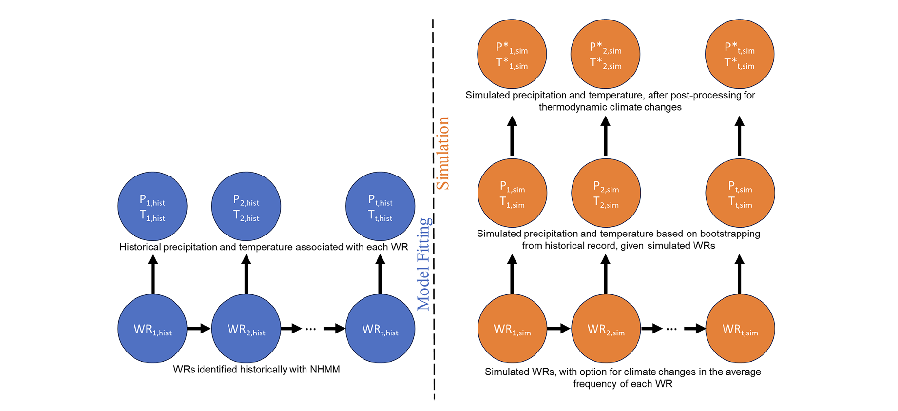
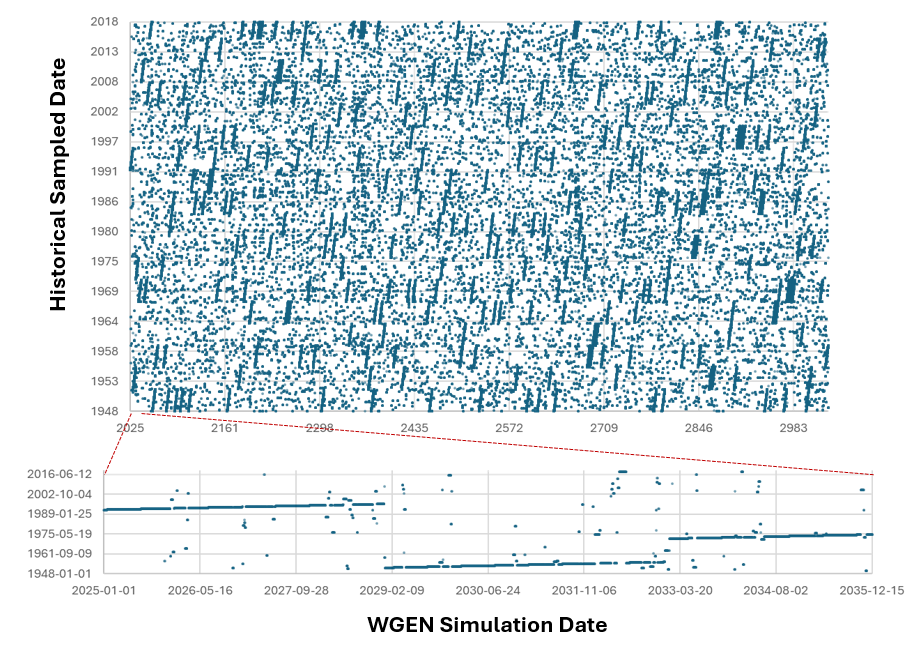
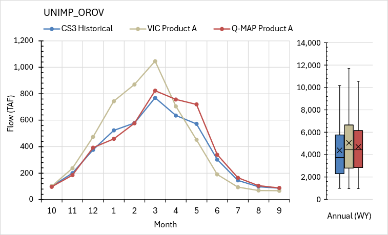
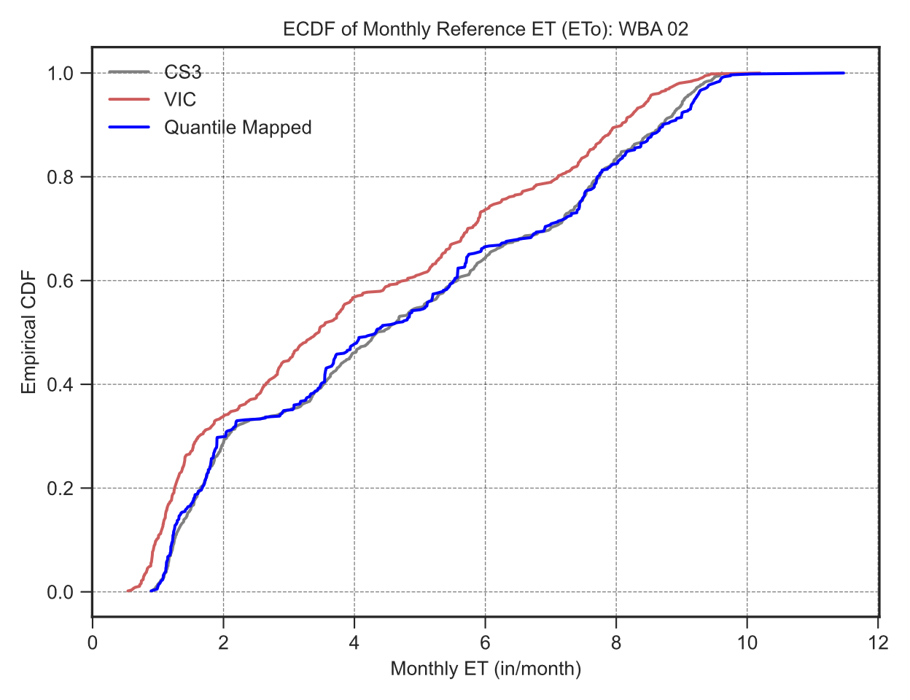

# Methods

This section describes the technical approaches used to transform synthetic weather into the full suite of CalSim 3 inputs. The pipeline starts with a Weather Generator that produces plausible daily climate sequences, passes those through physical models, and applies statistical reconstruction methods to bridge any remaining gaps.

## WGEN (the "Weather Generator")

The WGEN is a Non-Homogeneous Hidden Markov Model (NHMM) that generates synthetic daily temperature and precipitation by simulating transitions between eight weather regimes derived from historical atmospheric circulation over the western United States. For each simulated day, the model selects a weather regime, then bootstraps daily precipitation and temperature from the pool of historical days sharing that regime. This preserves observed relationships between large-scale atmospheric patterns and local weather outcomes.

The algorithm samples historical dates in 4-year blocks to maintain multi-year persistence: consecutive drought winters or extended pluvial periods that purely random regime simulation would underrepresent. Within each block, roughly 70--85% of days come from the same historical 4-year period; the remainder are drawn from other periods when regime transitions require alternative source dates.

For heavy precipitation events, a copula-based jittering step adds noise to resampled values, so the synthetic record can occasionally exceed historical maxima while preserving the statistical structure of the data.

The pipeline runs on three weather sets. Historical_Unsplit is the gridded historical record (1915--2018) without the temperature detrending. Product A is the same record with its temperature detrended. Product B spans 1,000 years with entirely new regime sequences unconstrained by historical chronology, and is the planning dataset.

::::{tab-set}
:::{tab-item} Algorithm Overview

*WGEN two-phase algorithm. Model fitting classifies historical weather into regimes. Simulation generates new regime sequences and bootstraps daily weather from matching historical days.*
:::
:::{tab-item} Sampling Patterns

*Sampling date patterns showing which historical dates (y-axis) are sampled for each simulation period (x-axis). Top panel: portion of the 1,000-year simulation. Bottom panel: 10-year detail. Diagonal bands indicate the 4-year block sampling structure.*
:::
:::{tab-item} Weather sets
| | Historical_Unsplit | Product A | Product B |
|---|---|---|---|
| Weather | Historical record, 1915--2018 | The record with detrended temperature | 1,000 years of stochastic regime sequences |
| Delivered | WY 1922--2018 | WY 1922--2018 | 10 chunks of 100 water years |
| Purpose | Validation against the CalSim 3 baseline | Historical sequence under detrended temperature | Stochastic planning runs |
:::
::::

## From weather to CalSim inputs

Synthetic weather enters CalSim through two pathways: **model-based generation**, where physical process models are driven directly with WGEN climate, and **statistical reconstruction**, where quantile mapping or other methods transform model outputs into CalSim variables.

Six process models (SAC-SMA, CalSimHydro, CalSimHydroEE, Small Watersheds, DCD, and Reservoir Evaporation) produce over 1,200 variables, about 80% of all generated inputs. SAC-SMA's monthly arc flows become the rim inflows without bias correction. CalSimHydro and CalSimHydroEE run on WGEN precipitation and on reference ET computed from WGEN temperature; Small Watersheds runs on precipitation with a fixed ET pattern, and DCD on station precipitation and Lodi temperature.

The remaining ~20% of variables lack a direct process model and are reconstructed statistically. The method chosen for each variable depends on its physical characteristics and how well it correlates with available model outputs:

```{mermaid}
%%{init: {'flowchart': {'nodeSpacing': 50, 'rankSpacing': 10}}}%%
flowchart LR
    START(["Variable to<br/>Reconstruct"]) --> PHYS{"Physical<br/>model?"}
    PHYS -->|Yes| MODEL["Model-Based<br/>Generation"]
    PHYS -->|No| FORMULA{"Known<br/>physical<br/>relationship?"}
    FORMULA -->|Yes| DIRECT["Direct<br/>Calculation"]
    FORMULA -->|No| CORR{"R&sup2; with<br/>inflow?"}
    CORR -->|"> 0.5"| QM["Quantile<br/>Mapping<br/>(or Hybrid QM)"]
    CORR -->|"< 0.5"| PATTERN{"Regular<br/>seasonal<br/>pattern?"}
    PATTERN -->|Yes| WYT_AVG["WYT Monthly<br/>Averaging"]
    PATTERN -->|No| STITCH["WGEN Date-<br/>Stitching"]
    PATTERN -->|No| FLOW["Flow Index<br/>Matching"]

    style MODEL fill:#2d6a4f,color:#fff
    style QM fill:#2d6a4f,color:#fff
    style WYT_AVG fill:#2d6a4f,color:#fff
    style DIRECT fill:#2d6a4f,color:#fff
    style STITCH fill:#2d6a4f,color:#fff
    style FLOW fill:#2d6a4f,color:#fff
    style START fill:#264653,color:#fff
```

_Method selection decision tree. The appropriate reconstruction methodology for each variable is determined by available physical models, correlation strength with rim inflows or flow indices, seasonal pattern regularity, and WGEN date mapping availability._

## Input generation validation

Validation applies to the entire suite of generated inputs, not just the quantile-mapped variables but every variable produced by every module. The goal is to confirm that the full set of synthetic inputs, taken together, produces a CalSim run that behaves consistently with the historical baseline.

We validate on Historical_Unsplit, whose weather is the historical record, like the CalSim 3 baseline's. We do not validate Product A against CalSim 3: its temperature is detrended, so its difference from the baseline mixes the warming response with reconstruction error. Performance at the individual variable level is measured with coefficient of determination (R-squared), Nash-Sutcliffe Efficiency (NSE), and percent bias (PBIAS). The rim-inflow model is also scored on the years it does not train on ({doc}`input-generation/mod-hydrology-rim-inflow`).

Beyond variable-level checks, we compare a full CalSim 3 run on a set's complete inputs with the CalSim historical baseline run. Differences in the resulting system operations (reservoir storage, deliveries, Delta exports) reflect the cumulative effect of all input generation procedures and show whether the inputs are suitable for planning-scale analysis.


## Quantile mapping

Quantile mapping (QM) is the core statistical method. It establishes an empirical relationship between a basis time series (a rim inflow, basin temperature for VPD, or Hargreaves-Samani ETo for pan evaporation) and a target (CalSim historical input), then applies that relationship to transform new basis values into CalSim-compatible values.

Each calendar month is processed independently to preserve seasonal patterns:

1. Build empirical CDFs for both basis and target from the fit period
2. For each simulated basis value, interpolate its probability from the basis CDF
3. Invert the target CDF at that probability to obtain the mapped value
4. For values outside the historical range, fit a Gamma distribution for tail extrapolation
5. Zero-clip to prevent negative flows

::::{tab-set}
:::{tab-item} QM Diagram
```{mermaid}
flowchart LR
    subgraph basis["Basis Side (predictor)"]
        direction TB
        INPUT["Monthly<br/>Basis Value"] --> BCDF["Lookup in<br/>Basis CDF"]
    end

    BCDF --> RANGE{"In historical<br/>range?"}
    RANGE -->|Yes| EMP["Empirical<br/>percentile"]
    RANGE -->|No| GAMMA["Gamma-fitted<br/>percentile"]

    EMP --> INVERT
    GAMMA --> INVERT

    subgraph target["Target Side (CalSim)"]
        direction TB
        INVERT["Invert<br/>Target CDF<br/>at percentile"] --> CLIP["Zero-clip"] --> OUTPUT["Mapped<br/>CalSim Value"]
    end

    style basis fill:#e8f4f8,stroke:#264653
    style target fill:#e8f8e8,stroke:#2d6a4f
    style INPUT fill:#264653,color:#fff
    style OUTPUT fill:#2d6a4f,color:#fff
    style RANGE fill:#fff,stroke:#264653
```
_Quantile mapping transforms a basis value to a target value by passing through probability space. Each calendar month is processed independently._
:::
:::{tab-item} Example: QM Rim Inflow

_Example from v1.0: Oroville unimpaired inflow (UNIMP\_OROV) during its validation period (WY 1972--2018). Monthly average profiles (left) and annual distributions (right) compare CS3 Historical (blue), raw VIC Product A (tan), and quantile-mapped Product A (red). Quantile mapping corrects VIC's wet bias and brings the seasonal profile and annual distribution into closer agreement with the historical CalSim target._
:::
:::{tab-item} Example: QM ET

_Example from v1.0: empirical CDF comparison for monthly reference ET at WBA 02. Gray: CalSim 3 historical (target); Red: Raw VIC output (basis); Blue: Quantile-mapped VIC._
:::
::::

### Pass and absorb fits

Every quantile map that reads a rim inflow is fitted once, on WY 1950--2018, and applied to all three sets (`utils/qmap_fit.py`). Each pair of predictor and target names its fit:

- A pass fit trains on the CalSim 3 predictor against the CalSim 3 target and is applied to the rim-inflow model's predictor, so the term carries the model's error as its predictor does. The quantile-mapped rim-inflow SVs, MAMMOTH_STORAGE and the upper watershed channel terms use it.
- An absorb fit trains on the model's Historical_Unsplit predictor against the CalSim 3 target, so the map absorbs the model's bias and the term keeps CalSim 3's level. It suits a term tied to its predictor only statistically: TULE_WET_INDX, C_CBD001HIST and C_KLR005HIST.

No map is fitted on Product A, whose detrended temperature would enter the fit as model error. Two maps have a basis built from temperature and are fitted on Historical_Unsplit weather: basin VPD ({doc}`input-generation/mod-forcing-climate`) and Gerber pan evaporation ({doc}`input-generation/mod-hydrology-calsimhydro`).

Limits of quantile mapping:

- **Trend inheritance**: QM inherits long-term trends from the basis. If the predictor shows a drying trend, the mapped term will too.
- **Sequence preservation**: distributions are corrected but temporal sequencing follows the basis, so synthetic timing may differ from historical.
- **Tail extrapolation**: values outside the historical range rely on Gamma distribution assumptions that may not hold for truly extreme events.
- **Correlation threshold**: QM works best when basis and target are well-correlated (R-squared > 0.7). Performance degrades for weaker pairs.

## Alternative reconstruction methods

For variables where quantile mapping is unsuitable (weak correlation, no continuous basis series, or a known physical relationship), three principal alternatives are used.

**WYT Monthly Averaging** computes monthly averages conditional on water year type (W/AN/BN/D/C) using Sacramento or San Joaquin indices. It works for variables with regular seasonal patterns but weak direct correlation with rim inflows, such as diversions and scheduled operations. A **Hybrid QM** variant averages QM output with the WYT monthly means: $(QM + WYT) / 2$. This dampens excessive QM peak overshoots while adding interannual variability that flat WYT patterns lack.

**Direct Calculation** applies physical formulas where relationships are known. For example, NDOI precipitation accretion uses precip x area x coefficient (R-squared = 0.92). This category also includes threshold-based logic for allocation ratios optimized with Excel Solver, and Hargreaves-Samani reservoir evaporation computed directly from WGEN temperature inputs.

**WGEN Date-Stitching** uses the WGEN's internal record of which historical dates were sampled for each synthetic day. Each synthetic month's value is a weighted average of historical values, weighted by the share of days drawn from each historical period. It applies to closure terms and other variables where the WGEN sampling pattern provides a natural link to historical conditions.

**Flow Index Matching** matches each synthetic water year to the single closest historical year by annual flow index similarity, then borrows that year's pattern wholesale. It applies to day volume fractions and other variables where annual hydrologic conditions, rather than daily sampling patterns, determine the appropriate historical analog.
